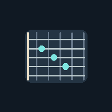
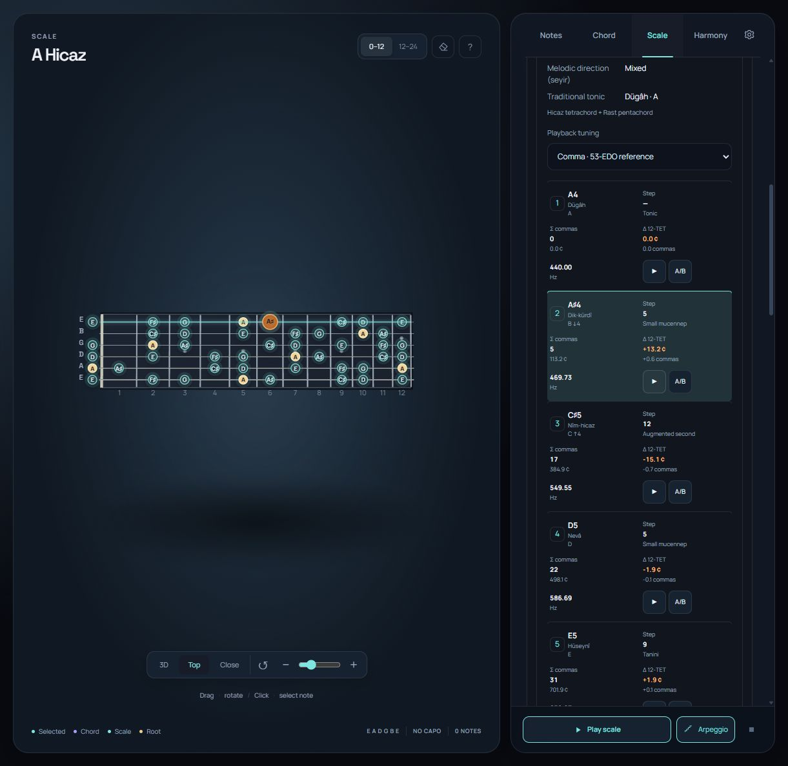

<div align="center">
  
  <h1>Guitar Brain · Koma</h1>
  <p><strong>Hear the fretboard. Explore the harmony. See the commas.</strong></p>
  <p>A focused guitar theory studio for chords, scales, harmony, and Turkish makam.</p>
  <p>
    <a href="https://guitar.thespacebug.chatgpt.site/"><strong>▶ Open the live studio</strong></a>
    &nbsp;·&nbsp;
    <a href="#getting-started">Run it locally</a>
    &nbsp;·&nbsp;
    <a href="LICENSE">MIT License</a>
  </p>
  <p>
    
    
    
  </p>
</div>

<p align="center">
  
</p>
<p align="center"><em>A Hicaz scale: the interactive fretboard alongside its makam interval and playback panel.</em></p>

## One fretboard, several ways to think

Start from notes you select, a chord you want to play, or a scale you want to understand. Guitar Brain connects the fretboard to practical voicings and a contextual harmony map, then lets you hear the result.

| Explore | What you can do |
| --- | --- |
| **Notes** | Mark fretboard notes and discover exact or plausible chord and scale matches without discarding selected pitches. |
| **Chords** | Compare playable voicings, inspect compact chord diagrams, filter by voicing family, and strum or arpeggiate. |
| **Scales** | Browse major, minor, modal, symmetric, blues, bebop, pentatonic, and Turkish makam collections in English or Turkish. |
| **Harmony** | Inspect scale degrees and contextual relationships such as secondary dominants, borrowed chords, and tritone substitutes. |
| **Makam** | Compare theoretical 53-EDO steps, cents, nearby 12-TET guitar frets, and hear the selected interval model. |
| **Make and share** | Tune the guitar, set a capo, play or export MIDI, save a project, and export fretboard or chord graphics. |

## Makam and the comma model

Makam records use theoretical coordinates on a 53-equal-division reference. Playback can sound those relative intervals continuously through the browser audio engine. The app keeps that theoretical model separate from the nearest 12-TET guitar-fret projection, so a colored fret marker does not imply that a standard fretted guitar can play the exact microtone.

This is an educational reference, not a measurement of a performer’s intonation or a complete makam performance simulator. The app does not export makam tuning as microtonal MIDI/MPE, and its harmony map does not claim to model traditional makam harmony.

## Getting started

The app has no package-install step. Serve this folder locally so the service worker and installable PWA features can run:

```sh
python -m http.server 8000
```

Then open <http://localhost:8000>.

To generate a portable, single-file copy:

```sh
node build-standalone.js
```

To run the included automated checks:

```sh
node tests/run.cjs
```

## Research notes

- [Makam reference and modeling choices](MAKAM-REFERENCE.md)
- [Makam research](Makam_Arastirmasi.md)
- [Scale systems and harmony research](SCALE-HARMONY-RESEARCH.md)
- [Scale and harmony atlas](SCALE-HARMONY-ATLAS.md)
- [Chord voicing research](VOICING-RESEARCH.md)
- [Chord matching and audio notes](CHORD-MATCHING-AUDIO.md)

## Credits and licensing

The project source is available under the [MIT License](LICENSE). Bundled material retains its own terms; see [Third-party notices](THIRD-PARTY-NOTICES.md) and the license files next to each asset. The guitar recordings are from FreePats and dedicated to the public domain under CC0. Manrope and Space Grotesk are distributed under the SIL Open Font License.

<p align="center"><sub>Built for curious guitarists, composers, and theory learners.</sub></p>